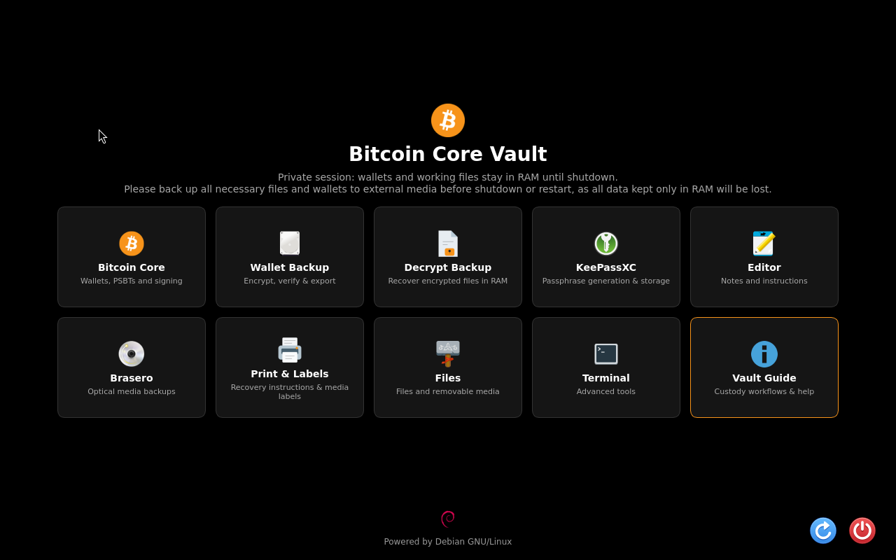
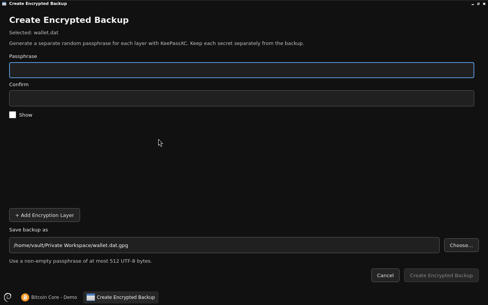
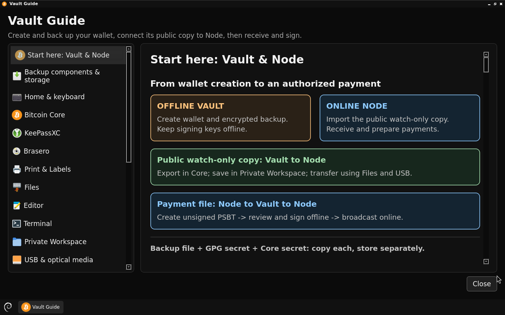

# Bitcoin Core Vault

Bitcoin Core Vault is a dedicated offline environment for creating and restoring
Bitcoin Core wallets, signing PSBTs and exporting encrypted wallet backups. It
uses Debian 13 Trixie on amd64 and the unmodified Bitcoin Core 32.1 application.
Use a separate online Bitcoin Core node to prepare transactions and broadcast
the signed result.

Run Vault as a Live RAM session or install its operating system on an internal
disk. In both modes, the Vault account's home and private working data stay in
RAM. Export the files you want to keep before ending the session.

**[Download Bitcoin Core Vault v0.6.0](https://github.com/btcpavao/bitcoin-core-vault-releases/releases/tag/v0.6.0).** The stable
release includes Bitcoin Core 32.1, USB destinations for encrypted backups and
recovery, Quick Delete and three-pass Secure Delete. The new boot screen
explains offline signing and RAM-only wallet storage.

[Verify the signed ISO](#release-verification-and-status) or
[rebuild v0.6.0 from source](docs/REBUILD.md).

A single valid Bitcoin Core SQLite
`wallet.dat` is encrypted directly using standard AES-256 CFB+MDC OpenPGP,
without TAR. With two separate passphrases, decryption is
`wallet.dat.gpg.gpg` → `inner.gpg` → `wallet.dat`. TAR is used only for
multiple files or folders. The built-in recovery tool also reads previous
GPG/TAR and AES-256 OCB backup files.

The project is independently developed. An independent security audit has yet to be published.

## Screenshots

View the [v0.6.0 installed boot screen](https://github.com/btcpavao/bitcoin-core-vault-releases/releases/download/v0.6.0/vault-boot.png) and the backup dialogs in [Create](https://github.com/btcpavao/bitcoin-core-vault-releases/releases/download/v0.6.0/vault-create-backup.png) and [Decrypt](https://github.com/btcpavao/bitcoin-core-vault-releases/releases/download/v0.6.0/vault-decrypt-backup.png). The embedded gallery below shows an earlier v0.4.0 demonstration session at 1280 × 800.

### Offline workspace



Wallet tools, encrypted backups and recovery in one place.

### Create Encrypted Backup



The native backup interface with empty passphrase fields. The demonstration wallet is unfunded.

### Vault Guide



Built-in guidance for wallet protection and recovery.

[Capture details](docs/screenshots/CAPTURE.json) · [Website gallery](https://btcpavao.com/en/bitcoin-core/debian-images/#vault)

## Use Vault

The boot configuration provides **Start Bitcoin Core Vault (Live RAM)** and
**Install Bitcoin Core Vault**. The first uses `toram`; the second opens the
Calamares installer.

Home contains ten launchers: Bitcoin Core, Wallet Backup, Decrypt Backup,
KeePassXC, Editor, Brasero, Print & Labels, Files, Terminal and Vault Guide.
Applications and resizable file dialogs open maximized; fixed-size dialogs keep
their native size. Num Lock is enabled at startup. KeePassXC opens its stock
passphrase generator with six words as the initial default.

Keep the signing computer disconnected from networks. Vault disables network
interfaces and radios, and Core runs with peer networking inactive. Helper RPC
uses loopback and cookie authentication. No blockchain synchronization occurs.

Copy imported wallet and PSBT files into RAM before working on them in Core.
Core's filesystem isolation permits writes only to checked RAM locations.
Use **Wallet Backup** for wallet exports and **Files** to transfer signed PSBTs
to external media.

## Watch-only wallet

Use **Bitcoin Core → File → Export watch-only wallet** to save `watch-only.dat`
in Private Workspace (the default export folder), then copy that public file to USB using Files. On an
online computer running Core 32.1 or newer, use **File → Restore Wallet**.
File choosers have wider Places sidebars and show mounted USB volumes. The USB Media shortcut also lets an already-open Core process read newly attached media; Core still saves only to checked RAM locations.
Vault no longer includes a separate watch-only export tool or its JSON format.
Keep the original signing wallet offline. See [the native workflow](docs/WATCH-ONLY.md).

## RAM session and installation

`/home/vault` is backed by `/run/core-vault/home` on a protected RAM filesystem.
Wallets, settings, logs, application state, temporary files and verification
records are volatile. Storage checks run before the desktop and Core start;
swap, persistent crash dumps and suspend/hibernate are disabled by policy.

An installation persists Debian, program binaries and immutable defaults,
while user session files remain volatile. Calamares erases the selected whole
internal disk after review and confirmations. Keep backup media disconnected
while installing. This profile has no dual boot, manual partitioning or full-disk
encryption. Secure Boot is disabled in the build configuration.

Use the Home power controls and **Finish Private Session** when done. Finish
shows two warnings, then a cancellable five-minute countdown before ending RAM.
It does not request passphrases or verify backups. Closing
an application does not end the session; power loss loses unsaved RAM data.
Other files, password databases and signed PSBTs also need to be exported.

The RAM policy does not erase previously written disk data or promise physical
RAM sanitization. See [the current session design](tools/core-vault/docs/RAM-PRIVATE-SESSION.md)
for the implemented storage boundaries and failure behavior.

## Back up and recover a wallet

Choose **Wallet Backup** on Home for a consistent Bitcoin Core snapshot, or
**Files → Create Encrypted Backup** for selected files and folders. Generate
independent random passphrases with KeePassXC, confirm each layer and choose a
new .gpg destination. Select the mounted USB drive to save the encrypted file
directly on it, or keep the default in Private Workspace. No external drive is required to create a backup. Files saved only in RAM
are lost when the session ends; copy what you need to retain before shutdown or
restart. One layer is enough for a basic encrypted backup;
the interface supports up to 16. Whole-backup readback is checked before publication.

Open the backup through **Decrypt Backup** or Files, and enter its passphrases
in any order. Original names and folder structure are restored into a new folder
in Private Workspace by default. To recover directly to USB, select the mounted
drive and choose a new folder name. The recovered files stay on the USB after
shutdown without the outer GPG protection. Core's **Restore Wallet** opens the recovered
wallet.dat. If internally encrypted, the wallet still needs its separate Core
passphrase for signing. Verify addresses and signing using disposable test data.

Originals and existing backups are never overwritten or deleted. During backup creation, only ciphertext
is staged on the destination disk. When needed, TAR archives, decrypted layers and snapshots
stay in verified private RAM. Resource limits are 16 layers, 10,000 entries and
256 MiB per package, further reduced when available RAM is limited.

Direct wallet exports are verified during backup creation. Use Wallet Backup for
each current wallet. Before finishing, save and verify everything you need;
shutdown confirmations do not check whether your backups are current.

## Choose an encryption arrangement

Core private-key encryption is optional and separate from GPG whole-file privacy.
Use extra GPG layers only when independent handling of their secrets justifies
the extra recovery dependencies. Multi-layer encryption is not Bitcoin multisig.
Keep redundant backup copies and redundant secret recovery arrangements in
appropriate separate locations. Geographic separation can delay access under
coercion; it does not guarantee protection from continued coercion.

KeePassXC starts with **Clear clipboard after** unchecked. This deliberately
leaves copied secrets accessible to local applications for longer. Enable
automatic clearing in **Tools → Settings → Security** if preferred. Relaunching
the application preserves that choice within the session; a fresh volatile
profile starts with the image defaults.

[The integrated and portable guide](docs/GPG-BACKUP.md) covers threat models,
inheritance, stock GnuPG/TAR recovery and the distinction from multisig. Recovery
does not require Vault: current GnuPG supporting AES-256 CFB+MDC and Bitcoin Core are sufficient
for direct single-wallet backups. TAR is additionally needed for grouped
backups; old OCB archives require a GnuPG implementation with OCB support.
Test recovery on the actual target operating system before relying on it.

## Rebuild and compare the ISO

[The step-by-step build guide](docs/REBUILD.md) checks out the
[exact v0.6.0 source](https://github.com/btcpavao/bitcoin-core-vault-releases/commit/26e590741c968316b99416c51a53b9720d8134cb), compiles Calamares, Thunar and Vault
Backup, and assembles the ISO from the pinned Debian, Bitcoin Core and KeePassXC
inputs. It explains how to compare a locally built image with the signed download.
The [release tag's GitHub Actions run](https://github.com/btcpavao/bitcoin-core-vault-releases/actions/runs/43397223031) records the two hosted builds,
their byte comparison and the UEFI installation check.

## Release verification and status

Download `bitcoin-core-vault-v0.6.0-amd64.iso`, `SHA256SUMS`,
`SHA256SUMS.asc` and `btcpavao-pgp.asc` from the
[v0.6.0 release](https://github.com/btcpavao/bitcoin-core-vault-releases/releases/tag/v0.6.0). The ISO is **714,080,256 bytes** and its SHA-256 is

```text
d1e3656099875e6cde7ed6c78fcf9ee3217d8bed4f8ccd5500b4231ad6bfa8ba
```

Inspect the public key with `gpg --show-keys --with-fingerprint btcpavao-pgp.asc`
and confirm the full maintainer fingerprint through a channel you already trust.

```text
787A 2AAF B0D1 19CA 0522 B2A5 B9C9 9AF8 5788 96D0
```

The website also publishes the [fingerprint](https://btcpavao.com/pgp.txt)
and the [armored public key](https://btcpavao.com/btcpavao-pgp.asc). After confirming the fingerprint, run these commands in Bash with GnuPG
2.4.7 or newer (included with Debian 13) from the download directory. The temporary keyring keeps this check separate from your
personal keys.

```bash
(
  set -euo pipefail
  keyring=$(mktemp -d)
  trap 'rm -rf -- "$keyring"' EXIT
  gpg --homedir "$keyring" --batch --import btcpavao-pgp.asc
  gpg --homedir "$keyring" --batch --assert-signer 787A2AAFB0D119CA0522B2A5B9C99AF8578896D0 --verify SHA256SUMS.asc SHA256SUMS
  iso=bitcoin-core-vault-v0.6.0-amd64.iso
  awk -v name="$iso" '$2 == name || $2 == "*" name {print; n++} END {if (n != 1) exit 1}' SHA256SUMS |
    sha256sum --strict --check -
)
```

GnuPG should report a good signature from the confirmed key. The following
line should name the v0.6.0 ISO and report `OK`. The [v0.6.0 acceptance record](https://github.com/btcpavao/bitcoin-core-vault-releases/releases/download/v0.6.0/ACCEPTANCE.json) lists the tests on the approved image. The
[v0.5.0 release](https://github.com/btcpavao/bitcoin-core-vault-releases/releases/tag/v0.5.0) retains the signed
checksums and Guide test results for that earlier image.

### Historical v0.4.0 tests

The v0.4.0 `ACCEPTANCE.json` records the exact-image test scope: BIOS Live operation,
UEFI Live boot and installation, installed operation, native backup and recovery,
synthetic recovered-wallet signing, Finish controls, restart checks and test-marker
scans on virtual disks. The QA evidence bundle includes release-specific adapters
for the current GPG backup and Finish interfaces, their hashes and preserved failed
attempts. Older probes in the source snapshot target the previous interface;
use the accompanying adapters to inspect this release's recorded tests.

USB optical-reader discovery and Brasero startup were tested with emulated
hardware. **Writing to a physical external DVD burner has not been verified.**
The image includes `core-vault-optical-diagnostics` for collecting read-only
information about a specific drive. See the [release notes](docs/RELEASE-v0.4.0.md)
for the remaining scope and limitations. Previous physical-machine reports apply
to their original releases, not automatically to this ISO.

## Source and licenses

The public release repository contains a standalone snapshot of tracked
Vault sources, build scripts, patches, notices and reviewed package inputs.
The separate private development repository and its historical Git commit
tree are not exposed. The ISO belongs to GitHub Release assets, not Git.
The [v0.6.0 source snapshot](https://github.com/btcpavao/bitcoin-core-vault-releases/releases/download/v0.6.0/bitcoin-core-vault-v0.6.0-source.tar.gz)
contains the tagged files for inspection. The build guide uses a Git checkout
so the builder can archive the exact committed tree. The [earlier native
candidate record](docs/rebuilds/71242344618b.md) and [assembly candidate
record](docs/rebuilds/9f466c5df912.md) preserve the results for those revisions.

Original Vault integration is licensed under the scoped [MIT license](LICENSE).
Upstream programs, patches, libraries and artwork retain their own licenses.
See [THIRD_PARTY_NOTICES.md](THIRD_PARTY_NOTICES.md) and
[the test record](docs/TESTING.md).
