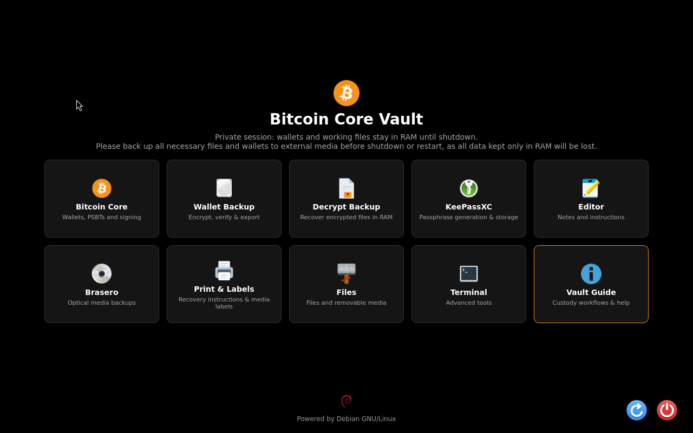
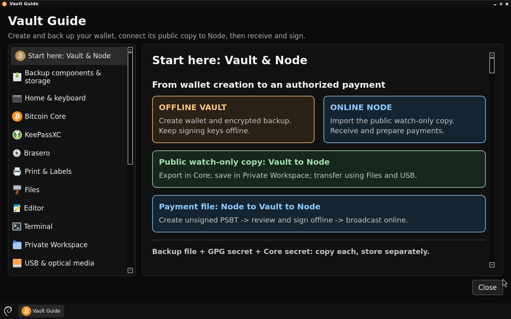
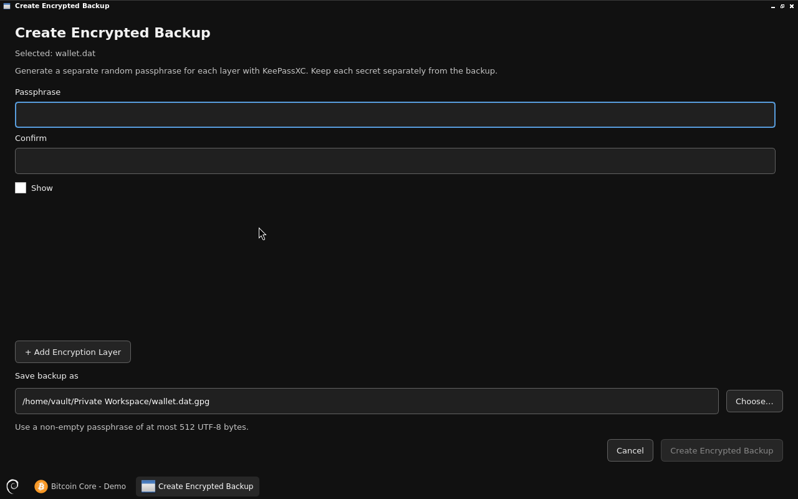

# Bitcoin Core Vault

Developer entry: [Vault & Node Development Reference](docs/development/README.md). Start there for current source/ISO identity, module boundaries, UI standards and the change/update workflow.

Bitcoin Core Vault is a dedicated offline environment for creating and restoring
Bitcoin Core wallets, signing PSBTs and exporting encrypted wallet backups. It
uses Debian 13 Trixie on amd64 and the unmodified Bitcoin Core 32.1 application.
Use a separate online Bitcoin Core node to prepare transactions and broadcast
the signed result.

Run Vault as a Live RAM session or install its operating system on an internal
disk. In both modes, the Vault account's home and private working data stay in
RAM. Export the files you want to keep before ending the session.

**[Download Bitcoin Core Vault v0.9.0 for amd64](https://github.com/btcpavao/bitcoin-core-vault-releases/releases/download/v0.9.0/bitcoin-core-vault-v0.9.0-amd64.iso).** This release adds Legacy BIOS and UEFI advanced installation, automatic Apple T2 kernel selection, installed device preferences, corrected Date & Time controls, a desktop clock and a compact application taskbar.

[Verify the signed download](#release-verification-and-status) · [Inspect the source and build status](docs/REBUILD.md) · [Release notes](docs/RELEASE-v0.9.0.md)

The published ISO is the exact locally built image approved after testing. Its source and retained build evidence are supplied. An independent byte-identical rebuild of **v0.9.0** has not been established; the earlier v0.8.0 reproducibility results remain specific to that release.

The publication source includes one [documented review-metadata correction](docs/REBUILD.md#known-metadata-difference) made after ISO assembly. The accepted ISO retains its original metadata; a complete current source-to-ISO payload-gate pass is not claimed.

A single valid Bitcoin Core SQLite
`wallet.dat` is encrypted directly using standard AES-256 CFB+MDC OpenPGP,
without TAR. With two separate passphrases, decryption is
`wallet.dat.gpg.gpg` → `inner.gpg` → `wallet.dat`. TAR is used only for
multiple files or folders. The built-in recovery tool also reads previous
GPG/TAR and AES-256 OCB backup files.

The project is independently developed. An independent security audit has yet to be published.

## Screenshots

These screenshots show the Live RAM desktop, its built-in guide and an installed session of Vault v0.6.0. The backup example uses a disposable USB drive.

### Offline workspace



Open Bitcoin Core to create a wallet or sign a transaction offline. The current session keeps wallets and working files in RAM.

### Practical Vault Guide



The first chapter shows which computer creates the watch-only copy, prepares the payment and signs it.

### Wallet Backup



Open **Save to** and choose your mounted backup drive to keep the encrypted file after shutdown.

[Decrypt Backup screenshot](docs/screenshots/recover.png) · [Capture details](docs/screenshots/CAPTURE.json) · [Website gallery](https://btcpavao.com/en/bitcoin-core/debian-images/#vault)

## Use Vault

The boot configuration provides **Start Bitcoin Core Vault (Live RAM)** and
**Install Bitcoin Core Vault**. The installer offers **Install to disk** and
**Advanced partitioning**. Compatible Apple T2 models select the included T2
kernel automatically; other machines use the standard Debian kernel. The image
is for 64-bit Intel/AMD computers. Apple Silicon and 32-bit-only EFI are outside
this image. See [installation and hardware details](docs/ADVANCED-INSTALLATION.md).

Home contains ten launchers: Bitcoin Core, Wallet Backup, Decrypt Backup,
KeePassXC, Editor, Brasero, Print & Labels, Files, Terminal and Vault Guide.
Applications and resizable file dialogs open maximized; fixed-size dialogs keep
their native size. Num Lock is enabled at startup. KeePassXC opens its stock
passphrase generator with six words as the initial default.

Settings, Restart and Shutdown are grouped at the bottom right. The date and
time appear above them; clicking the clock opens Date & Time. When open-window
names no longer fit the bottom taskbar, they collapse to icons with full-title
hover text. Closing enough windows restores the names automatically.

Keep the signing computer disconnected from networks. Vault disables network
interfaces and radios, and Core runs with peer networking inactive. Helper RPC
uses loopback and cookie authentication. No blockchain synchronization occurs.

Use **File → Load PSBT from file…** to open an unsigned PSBT on the transfer
drive. Review the payment, choose **Sign Tx**, then **Save…**. Select the
mounted drive and give the signed file a distinct name, such as
`payment-signed.psbt`. Wait for the export to finish before ejecting the drive.
Use **Wallet Backup** for an encrypted backup of the signing wallet.

## Watch-only wallet

Use **Bitcoin Core → File → Export watch-only wallet** to save `watch-only.dat`
directly to a mounted writable transfer drive or temporarily in Private Workspace. On an
online computer running Core 32.1 or newer, use **File → Restore Wallet**.
If the watch-only file includes address book or transaction records, Vault asks
for confirmation before writing it to USB. **Cancel** leaves the drive untouched
and Core displays **Export Error**. Choose **Export wallet** to write the file.
Core displays **Export Successful** after Vault confirms the write.
File choosers have wider Places sidebars and show mounted USB volumes. If you attach the drive while Core is open, look under **USB Media** or reopen the chooser.
Vault no longer includes a separate watch-only export tool or its JSON format.
Keep the original signing wallet offline. See [the native workflow](docs/WATCH-ONLY.md).

## RAM session and installation

`/home/vault` is backed by `/run/core-vault/home` on a protected RAM filesystem.
Wallets, normal application state, logs, temporary files and verification
records are volatile. An installed Vault separately saves validated display,
keyboard, mouse and time-zone preferences as device configuration; a Live RAM
session keeps those changes only for the session. Storage checks run before the desktop and Core start;
swap, persistent crash dumps and suspend/hibernate are disabled by policy.

An installation persists Debian, program binaries, immutable defaults and the
limited device preferences described above, while private session files remain
volatile. **Install to disk** replaces the selected eligible internal disk after
review and confirmation. **Advanced partitioning** can format an explicitly
selected root partition, create a layout in unallocated space and reserve space
for Node. It does not shrink or move existing filesystems. Review identifies the
selected disk and all planned changes. Full-disk encryption and Secure Boot are
not included. Keep backup media disconnected while installing. Someone with
access to the installed disk between sessions can alter programs that will
handle the next wallet. Keep the computer under physical control. If the disk
may have been altered, start from a freshly verified image on write-protected
media and trusted hardware before opening a wallet.

Use the Home power controls and **Finish Private Session** when done. Finish
shows two warnings, then a cancellable five-minute countdown before ending RAM.
It does not request passphrases or verify backups. Closing
an application does not end the session; power loss loses unsaved RAM data.
Other files, password databases and signed PSBTs also need to be exported.

The RAM policy does not erase previously written disk data or promise physical
RAM sanitization. See [the current session design](tools/core-vault/docs/RAM-PRIVATE-SESSION.md)
for the implemented storage boundaries and failure behavior.

## Back up and recover a wallet

Choose **Wallet Backup** on Home for a consistent Bitcoin Core snapshot, or
**Files → Create Encrypted Backup** for selected files and folders. Generate
independent random passphrases with KeePassXC, confirm each layer and choose a
new .gpg destination. Select the mounted USB drive to save the encrypted file
directly on it, or keep the default in Private Workspace. No external drive is required to create a backup. Files saved only in RAM
are lost when the session ends; copy what you need to retain before shutdown or
restart. One layer is enough for a basic encrypted backup;
the interface supports up to 16. Whole-backup readback is checked before publication.

Open the backup through **Decrypt Backup** or Files, and enter its passphrases
in any order. Original names and folder structure are restored into a new folder
in Private Workspace by default. To recover directly to USB, select the mounted
drive and choose a new folder name. The recovered files stay on the USB after
shutdown without the outer GPG protection. Core's **Restore Wallet** opens the recovered
wallet.dat. If internally encrypted, the wallet still needs its separate Core
passphrase for signing. Verify addresses and signing using disposable test data.

Originals and existing backups are never overwritten or deleted. During backup creation, only ciphertext
is staged on the destination disk. When needed, TAR archives, decrypted layers and snapshots
stay in verified private RAM. Resource limits are 16 layers, 10,000 entries and
256 MiB per package, further reduced when available RAM is limited.

Direct wallet exports are verified during backup creation. Use Wallet Backup for
each current wallet. Before finishing, save and verify everything you need;
shutdown confirmations do not check whether your backups are current.

## Choose an encryption arrangement

Core private-key encryption is optional and separate from GPG whole-file privacy.
Use extra GPG layers only when independent handling of their secrets justifies
the extra recovery dependencies. Multi-layer encryption is not Bitcoin multisig.
Keep redundant backup copies and redundant secret recovery arrangements in
appropriate separate locations. Geographic separation can delay access under
coercion; it does not guarantee protection from continued coercion.

KeePassXC clears a copied passphrase after 10 seconds by default. If the
clipboard expires before you finish, copy the same passphrase again. Adjust the
timeout in **Tools → Settings → Security**. A fresh Vault session restores the default.

[The integrated and portable guide](docs/GPG-BACKUP.md) covers threat models,
inheritance, stock GnuPG/TAR recovery and the distinction from multisig. Recovery
does not require Vault: current GnuPG supporting AES-256 CFB+MDC and Bitcoin Core are sufficient
for direct single-wallet backups. TAR is additionally needed for grouped
backups; old OCB archives require a GnuPG implementation with OCB support.
Test recovery on the actual target operating system before relying on it.

## Source, build inputs and reproducibility

[The v0.9.0 build guide](docs/REBUILD.md) explains how to verify the released
bytes, inspect the tagged source and prepare a new functional source build.
The [native package guide](docs/NATIVE-REBUILD.md) describes the exact retained
Calamares source companion, the packaged Thunar sources and the T2 input pins.

This ISO was assembled locally from an existing Vault base and reviewed
runtime/native/kernel inputs. The recorded local packaging scripts include
historical paths and intermediate-image dependencies. They are provenance,
not a claim that a fresh checkout currently recreates the complete ISO byte for
byte. The T2 binary is exactly pinned, but the upstream T2 build references a
mutable patch branch; the unknown patch commit is not invented.

The previous successful v0.8.0 rebuild instructions and comparison evidence
are preserved at the [v0.8.0 tag](https://github.com/btcpavao/bitcoin-core-vault-releases/blob/v0.8.0/docs/REBUILD.md)
and in [historical documentation](docs/history/v0.8.0/INDEX.md).

## Release verification and status

Download `bitcoin-core-vault-v0.9.0-amd64.iso`, `SHA256SUMS`,
`SHA256SUMS.asc` and `btcpavao-pgp.asc` from the
[v0.9.0 release](https://github.com/btcpavao/bitcoin-core-vault-releases/releases/tag/v0.9.0). The ISO is **1,133,379,584 bytes** and its SHA-256 is

```text
615067c09f573a4476c7039adc90e58f75a46bdf20a028fd3c58f3e300c832fe
```

Inspect the public key with `gpg --show-keys --with-fingerprint btcpavao-pgp.asc`
and confirm the full maintainer fingerprint through a channel you already trust.

```text
787A 2AAF B0D1 19CA 0522 B2A5 B9C9 9AF8 5788 96D0
```

The website also publishes the [fingerprint](https://btcpavao.com/pgp.txt)
and the [armored public key](https://btcpavao.com/btcpavao-pgp.asc). After confirming the fingerprint, run these commands in Bash with GnuPG
2.4.7 or newer (included with Debian 13) from the download directory. The temporary keyring keeps this check separate from your
personal keys.

```bash
(
  set -euo pipefail
  keyring=$(mktemp -d)
  trap 'rm -rf -- "$keyring"' EXIT
  gpg --homedir "$keyring" --batch --import btcpavao-pgp.asc
  gpg --homedir "$keyring" --batch --assert-signer 787A2AAFB0D119CA0522B2A5B9C99AF8578896D0 --verify SHA256SUMS.asc SHA256SUMS
  iso=bitcoin-core-vault-v0.9.0-amd64.iso
  awk -v name="$iso" '$2 == name || $2 == "*" name {print; n++} END {if (n != 1) exit 1}' SHA256SUMS |
    sha256sum --strict --check -
)
```

GnuPG should report a good signature from the confirmed key. The following
line should name the v0.9.0 ISO and report `OK`. The [build provenance](https://github.com/btcpavao/bitcoin-core-vault-releases/releases/download/v0.9.0/BUILD-PROVENANCE.json)
and [release notes](docs/RELEASE-v0.9.0.md) distinguish final-ISO content/UI checks,
earlier installer/settings checks and Pavao's physical-machine acceptance.
A successful checksum check authenticates the selected release bytes; it does
not replace hardware testing or a security review.

### Historical v0.4.0 tests

The v0.4.0 `ACCEPTANCE.json` records the exact-image test scope: BIOS Live operation,
UEFI Live boot and installation, installed operation, native backup and recovery,
synthetic recovered-wallet signing, Finish controls, restart checks and test-marker
scans on virtual disks. The QA evidence bundle includes release-specific adapters
for the current GPG backup and Finish interfaces, their hashes and preserved failed
attempts. Older probes in the source snapshot target the previous interface;
use the accompanying adapters to inspect this release's recorded tests.

USB optical-reader discovery and Brasero startup were tested with emulated
hardware. **Writing to a physical external DVD burner has not been verified.**
The image includes `core-vault-optical-diagnostics` for collecting read-only
information about a specific drive. See the [release notes](docs/RELEASE-v0.4.0.md)
for the remaining scope and limitations. Previous physical-machine reports apply
to their original releases, not automatically to this ISO.

## Source and licenses

The public repository preserves the published Git history. The
[v0.9.0 source snapshot](https://github.com/btcpavao/bitcoin-core-vault-releases/releases/download/v0.9.0/bitcoin-core-vault-v0.9.0-source.tar.gz)
contains the tagged Vault files for inspection; `SOURCE-COMMIT.txt` identifies
that revision and is covered by the release's checksum list. Large upstream
T2 inputs are fetched by exact size/hash pins instead of being stored in Git.
The matching Calamares companion supplies its retained application sources,
licenses, Debian packaging and original build evidence. The ISO is a GitHub
Release asset.

Original Vault integration is licensed under the scoped [MIT license](LICENSE).
Upstream programs, patches, libraries and artwork retain their own licenses.
See [THIRD_PARTY_NOTICES.md](THIRD_PARTY_NOTICES.md),
[the current release scope](docs/RELEASE-v0.9.0.md) and the
[historical test record](docs/TESTING.md).
